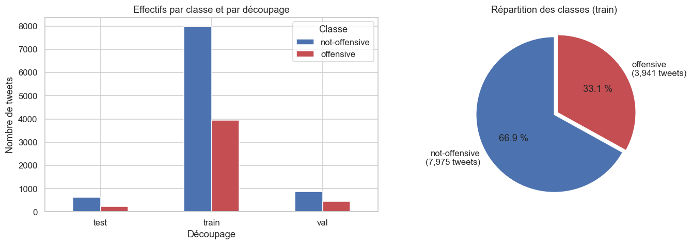
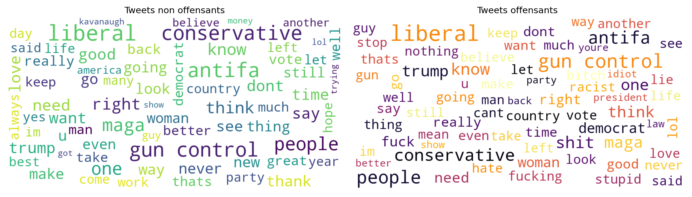
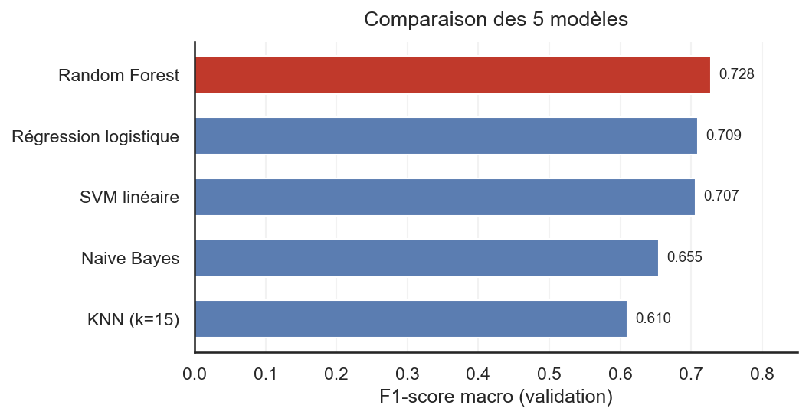
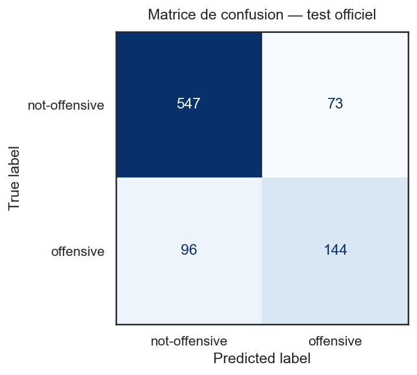

# Détection du langage offensant dans les tweets

**Mini-projet Machine Learning — TweetEval · Offensive** — Classe CI1, Faculté des Sciences de Bizerte.

Classer automatiquement un tweet comme **offensant** ou **non offensant**, avec des méthodes
classiques de Machine Learning (TF-IDF + 5 algorithmes comparés).

**Groupe :** *Jawher Monastiri, Taha Masmoudi, Lamis Oueslati*

[📓 Notebook](Mini_Projet_ML_TweetEval_Offensive.ipynb) · [🌐 Version HTML](Mini_Projet_ML_TweetEval_Offensive.html)

---

## Le jeu de données

Dataset **TweetEval – Offensive** (issu de SemEval-2019 OffensEval), tweets en anglais, découpage
officiel conservé.

| Découpage | Non offensant | Offensant | Total |
|---|---:|---:|---:|
| Entraînement | 7 975 (66,9 %) | 3 941 (33,1 %) | 11 916 |
| Validation | 865 | 459 | 1 324 |
| Test | 620 | 240 | 860 |

<p align="center"></p>

Le dataset est **déséquilibré** (2/3 – 1/3) : on utilise donc le **F1-score macro** comme métrique
principale, plus fiable que l'accuracy seule.

## Ce que fait le système

1. **Nettoyage** — minuscules, suppression des liens, mentions, ponctuation, allongements ;
   stopwords retirés **sauf les négations** (`not`, `never`, `dont`…), puis lemmatisation.
2. **Vectorisation** — TF-IDF uni- et bigrammes, 50 000 features, ajusté sur le train uniquement.
3. **Modélisation** — 5 algorithmes : régression logistique, SVM linéaire, Random Forest,
   Naive Bayes, KNN.
4. **Sélection** — choix du meilleur modèle sur la validation, puis test final unique sur le test.

<p align="center"></p>

## Résultats

| Modèle | F1 macro (validation) |
|---|---:|
| **Random Forest** ✅ | **0,7283** |
| Régression logistique | 0,7093 |
| SVM linéaire | 0,7065 |
| Naive Bayes | 0,6547 |
| KNN (k = 15) | 0,6101 |

<p align="center"></p>

Le modèle retenu (Random Forest) ré-entraîné sur *train + val* obtient sur le **test officiel** :

| Accuracy | Précision macro | Rappel macro | **F1 macro** |
|---:|---:|---:|---:|
| 0,8035 | 0,7571 | 0,7411 | **0,7482** |

<p align="center"></p>

Le modèle est fiable sur les tweets non offensants, mais **manque 40 % des tweets offensants**
(96 faux négatifs) : c'est la limite principale de l'approche sac-de-mots, détaillée dans le notebook.

## Contenu du dépôt

| Fichier | Rôle |
|---|---|
| `Mini_Projet_ML_TweetEval_Offensive.ipynb` | Notebook complet, exécuté et commenté |
| `Mini_Projet_ML_TweetEval_Offensive.html` | Version HTML du notebook |
| `models/best_model_offensive.joblib` | Modèle final (TF-IDF + classifieur) |
| `results/model_comparison.csv` | Tableau comparatif des 5 modèles |
| `predictions/offensive_ml.txt` | Prédictions sur le test, format TweetEval |
| `figures/` | Graphiques utilisés dans ce README |
| `requirements.txt` | Dépendances Python (versions testées) |

## Reproduire

```bash
pip install -r requirements.txt
python -m nbconvert --to notebook --execute --inplace Mini_Projet_ML_TweetEval_Offensive.ipynb
```

Ou simplement ouvrir le notebook dans Jupyter et l'exécuter depuis la racine du dépôt
(les dossiers `models/`, `results/` et `predictions/` sont créés automatiquement).

Les ressources NLTK (*stopwords*, *wordnet*) sont téléchargées automatiquement au premier lancement.
Les résultats sont déterministes (`random_state = 42`).

Le fichier `predictions/offensive_ml.txt` respecte le format attendu par `evaluation_script.py` :
recopié sous le nom `offensive.txt` dans un dossier de prédictions, il redonne exactement le score
**F1 macro = 0,7482** du benchmark.
